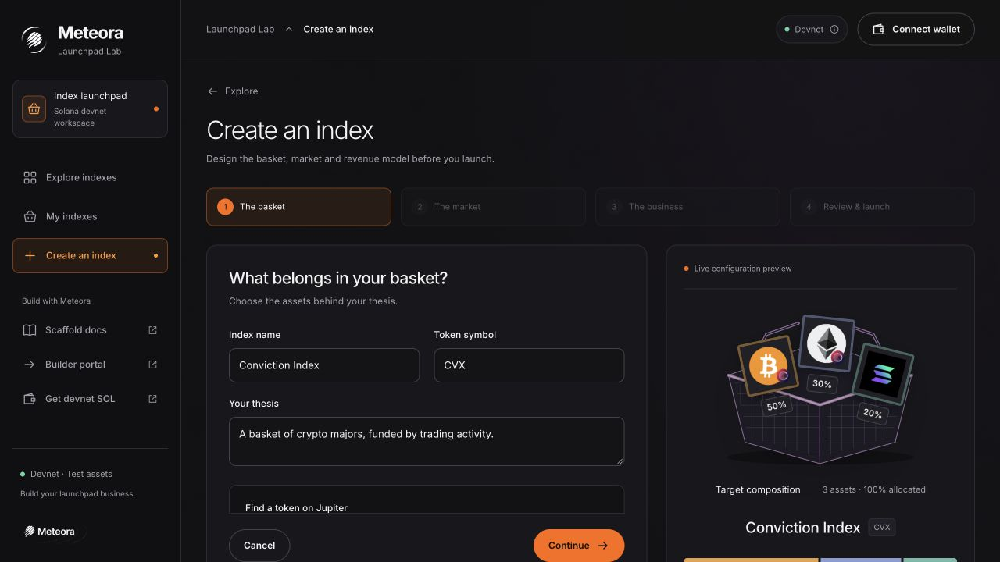
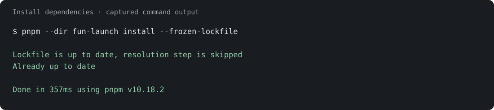
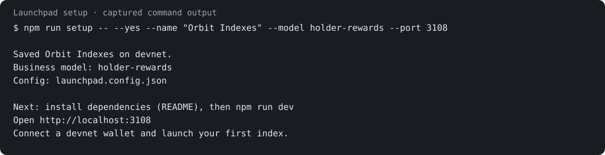
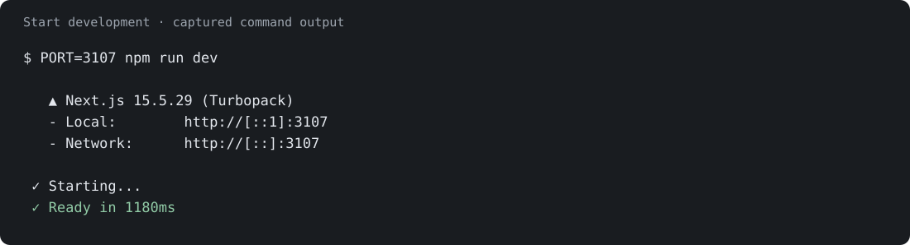
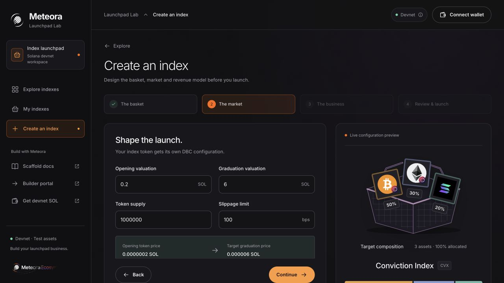
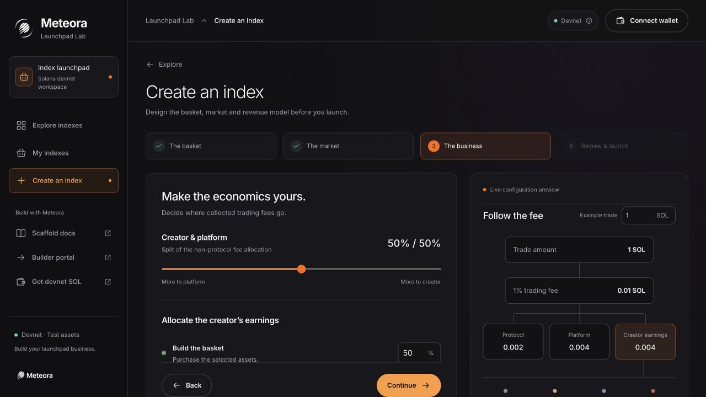
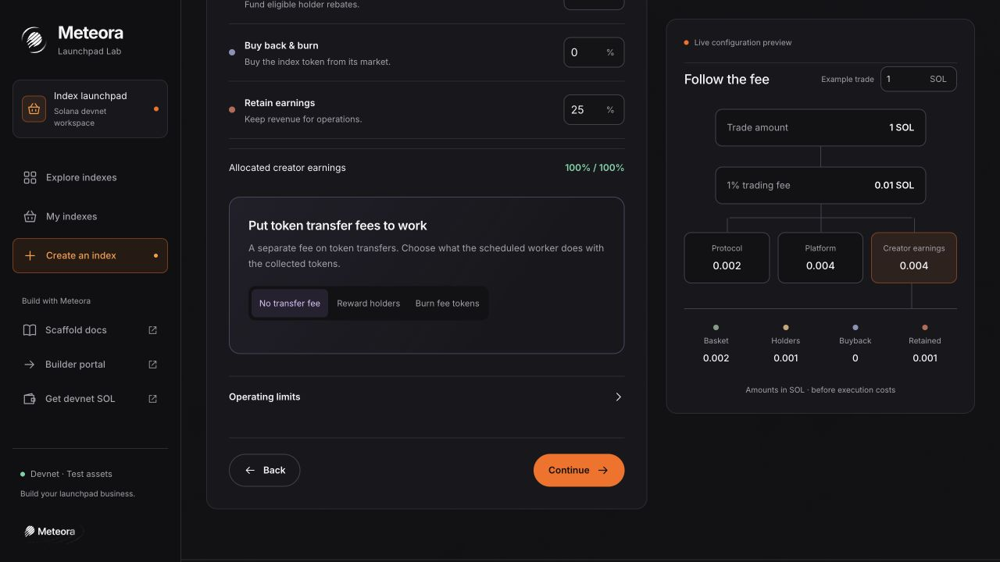

# Meteora Launchpad Lab

**Build an index launchpad. Set the business terms. See where every fee goes.**

An index launchpad scaffold built on Meteora’s [Fun Launch](https://docs.meteora.ag/invent/scaffold/fun-launch). Choose a basket, create a dedicated DBC configuration for each index token, and turn collected fees into basket purchases, holder rebates, buybacks or retained earnings.

[**Open the devnet demo →**](https://meteora.fyi/demo) · [Quick start](#quick-start) · [Create your first index](#create-your-first-index) · [Configuration](#configuration-reference)



> **Solana devnet.** Bring a wallet set to devnet and [test SOL](https://faucet.solana.com). The app creates fresh test tokens for basket assets. Jupiter supplies their names and source identities; these are not mainnet assets or real asset backing.

## What you can build

<table>
<tr>
<td width="50%"><strong>A basket of your choice</strong><br>Search Jupiter by name, symbol or mint. Combine 2–10 assets, set their weights and see the basket take shape. Each launch creates its own devnet copies.</td>
<td width="50%"><strong>A market for every index</strong><br>Create a separate DBC config and pool. Set supply, opening valuation, graduation target and the fee schedule before launch.</td>
</tr>
<tr>
<td><strong>A visible revenue model</strong><br>Choose creator/platform fee shares, then allocate collected creator revenue to basket purchases, rebates, buybacks and retained earnings.</td>
<td><strong>A working treasury</strong><br>Fund the basket, inspect holdings, change scenario prices and rebalance. Track confirmed transactions and budget movements.</td>
</tr>
<tr>
<td><strong>Holder incentives</strong><br>Demonstrate rebates for eligible registered holders. Buy back index tokens, then burn them in a separate signed operation.</td>
<td><strong>A market after graduation</strong><br>Migrate a completed curve to DAMM v2 with its own trading fee and liquidity allocations. Inspect the migrated pool and configured fee and liquidity terms.</td>
</tr>
</table>

## Quick start

### 1. Bring Node and a devnet wallet

- **Node.js 22.12+**
- A Solana wallet with devnet enabled
- Devnet SOL for transaction fees, account creation and trades

```sh
node --version
```

### 2. Set up your launchpad business

```sh
git clone https://github.com/meteora-fyi/demos.git
cd demos
npm run setup
```

The setup wizard runs before dependencies are installed. Give your launchpad a name and tagline, choose a business model, set the creator's fee share and trading fee schedule, and choose a local port. Accept **Install dependencies** to install the locked packages. You do not need a global pnpm installation.

| Starting model | Defaults for new launches |
| --- | --- |
| **Index** | Creator trading revenue: 50% basket purchases, 25% holder rebates, 25% retained. |
| **Holder rewards** | Index allocations plus a 1% token transfer fee earmarked for holder rewards. |
| **Fee burn** | Index allocations plus a 1% token transfer fee; collected index tokens are burned directly. |
| **Buyback** | Creator trading revenue: 25% basket purchases, 50% index-token buybacks, 25% retained. Buyback and burn remain separate operations. |

These presets are starting points. Every new launch can adjust its own terms before signing. Trading fees, token transfer fees and creator revenue allocations are separate settings. The transfer-fee processing schedule defaults to 300 seconds with a minimum of 0.001 collected index tokens; the wizard lets you change both. An interval alone does not enable automation or give the server wallet authority.

For a reproducible setup without prompts:

```sh
npm run setup -- --yes --install \
  --name "Orbit Indexes" \
  --tagline "Build a basket. Put trading fees to work." \
  --model holder-rewards \
  --creator-share 60 \
  --fee-mode linear --fee-bps 100 --ending-fee-bps 50 \
  --fee-duration 3600 --transfer-interval 300 --port 3000
```

Setup writes **`launchpad.config.json`** at the repository root. It contains public branding and validated launch defaults, never secrets. Keep it with your scaffold so teammates start with the same business terms. Existing launches keep their original configurations.



This capture shows the locked dependency install on an existing checkout. A fresh checkout also lists downloaded packages.



### 3. Configure local services

```sh
test -f fun-launch/.env.local || cp fun-launch/.env.example fun-launch/.env.local
```

The starter basket works without a Jupiter key. To enable token search, add your own key from [Jupiter’s developer portal](https://portal.jup.ag) to `fun-launch/.env.local`:

```dotenv
JUPITER_API_KEY=your-jupiter-api-key
```

For a workshop with multiple participants, also set an authenticated **devnet** `SOLANA_RPC_URL`. Otherwise the app uses a paced public devnet endpoint. Keys stay on the server; never prefix them with `NEXT_PUBLIC_`.

### 4. Start the app

```sh
npm run dev
```

Open the localhost URL printed by setup, normally **http://localhost:3000**. This command starts Next.js, token search and the transfer-fee scheduler together. Search reads cached results and queues fresh queries; the worker paces Jupiter requests and backs off when rate limited.



The capture uses port `3107` because another local server was running. The wizard's chosen port is used unless the `PORT` environment variable overrides it. The terminal images render actual command output.

### 5. Connect and create

Switch your wallet to **devnet**, obtain [test SOL](https://faucet.solana.com), and select **Create index**. Mainnet execution is rejected by the server’s network check.

<details>
<summary><strong>Repeat setup, use a settings file, or install manually</strong></summary>

Run `npm run setup -- --help` for all flags. A settings file uses this shape; omitted launch terms keep the selected model's defaults:

```json
{
  "version": 1,
  "network": "devnet",
  "name": "Orbit Indexes",
  "tagline": "Build a basket. Put trading fees to work.",
  "businessModel": "index",
  "port": 3000,
  "defaults": {
    "creatorShare": 60,
    "feeMode": "linear",
    "feeBps": 100,
    "endingFeeBps": 50,
    "feeDuration": 3600
  }
}
```

```sh
npm run setup -- --yes --config ./my-settings.json
```

Setup refuses to overwrite an existing config. To deliberately replace it, add `--replace`; the previous file is backed up alongside it first. CLI flags override corresponding input-file fields. To change the revenue model of a complete saved config, update its allocation and transfer-fee defaults too: explicit values in the input file take precedence over model presets. Restart the local server after changing its port.

If you skipped installation in the wizard:

```sh
npm ci
npm exec --yes --package=pnpm@10.18.2 -- pnpm --dir fun-launch install --frozen-lockfile
npm run dev
```

There are no wallet keys or funded accounts in this setup. It does not launch tokens, spend SOL or deploy a service. Account creation happens later through wallet-signed devnet transactions.

</details>

## Create your first index

### 1. Build the basket

Give the index a name, symbol and description. Start with the built-in assets or search Jupiter. Check the source mint when names or symbols collide, add assets, and make the weights total **100%**.


Adding a search result updates the draft immediately. During the signed launch steps, the app creates a **new devnet SPL mint for each constituent**, with six decimals. The Configuration tab records the source mint and the new devnet mint separately.

Jupiter is used for token discovery, not price execution. Custom assets start with a **0.01 test-SOL scenario price**, which can be changed later to demonstrate basket drift. No mainnet tokens are transferred.

### 2. Set the market

Choose the supply, opening valuation, graduation valuation and trading-fee schedule. Review the SDK-derived opening price and graduation reserve threshold before signing. The SDK derives the graduation reserve threshold: a valuation target and the cash needed to reach it are different numbers.



### 3. Set the business model

Choose how the creator and platform split the trading fee after the protocol share. Then decide how collected creator revenue funds the basket, rebates, buybacks and retained earnings. Use the fee-flow diagram to check the result.



### 4. Review and sign

Review the basket, market and revenue policy. Connect the devnet wallet and sign each prepared step. The app creates the configuration, index token, pool and test basket accounts through a sequence of transactions.

If interrupted, use the pending-operation panel to resume. Existing DBC terms remain fixed; **duplicate the index into a new draft** to compare a different model.

## Run the business

After launch, the index page groups the workflow into **Overview, Treasury, Earnings, Operations and Configuration**.

| Action | What happens | What to inspect |
| --- | --- | --- |
| **Buy or sell** | Your wallet swaps against the live DBC pool, or DAMM v2 after graduation. | Quote, price impact, received tokens and transaction receipt. |
| **Collect trading fees** | Confirmed creator and platform fees go to separate accounts. | Collected revenue and the creator’s allocated budgets. |
| **Fund basket** | The creator signs transfers that exchange wrapped devnet SOL for fixture constituents. | Actual holdings, target weights and remaining basket budget. |
| **Rebalance holdings** | Scenario-price changes create drift; prepared trades adjust the basket. Large baskets settle in several signed batches. | Before/after weights and each confirmed receipt. |
| **Pay eligible holders** | The creator signs a payout to eligible wallets registered through this demo. | Eligibility, interval and confirmed wrapped devnet SOL payments. |
| **Buy back → burn** | The treasury buys index tokens; a separate transaction burns acquired tokens. | Amount spent, tokens bought and tokens actually burned. |
| **Graduate** | Once the curve completes, a signed migration creates the DAMM v2 pool. | Migrated pool and configured fee and liquidity terms. |

For a rebate demonstration, trade with a second wallet through **Explore**, wait for an eligible interval, then use the creator’s workspace to sign the payout. The creator is excluded from rebates. Newly observed holders become eligible only after the required interval.

## Automate transfer-fee rewards or burns

Choose a transfer-fee model in setup or in **The business** step before launch. This creates a Token-2022 index token. Its transfer fee is independent of the DBC/DAMM trading fee.



| Model | What the worker does | What the holder receives |
| --- | --- | --- |
| **Holder rewards** | Collects withheld index tokens, snapshots eligible holders, then distributes proportionally. | Index tokens, net of the transfer fee on the payout. |
| **Fee-token burn** | Collects withheld index tokens and burns them directly. | No payout; the confirmed burn reduces supply. |
| **Trading-fee buyback** | Existing wallet-signed operation spends allocated SOL revenue to buy index tokens, followed by a separate burn. | This remains a different funding source and action from direct fee-token burn. |

Set the transfer fee, interval and minimum collected-token amount before launch. The signed launch assigns a dedicated devnet fee-withdrawal authority and funds it with **0.02 devnet SOL** for transaction costs. Its key remains server-side, with access limited to withheld fees and its own accounts. It has no authority to spend the creator’s treasury.

Open **Operations** to see collected, distributed or burned tokens, worker gas, next check and transaction receipts. **Pause automation** and **Resume automation** require the creator’s wallet signature. **Add 0.02 devnet SOL for gas** funds the worker when needed. Collection/payout transactions are journaled for retry recovery.

Rewards exclude creator, worker and pool accounts. They use balances at the cycle snapshot rather than promising time-weighted dividends. Minimums, insufficient gas or an incomplete holder scan can defer a cycle; the UI reports the reason. These features run only on devnet in this scaffold.

## Explore other launches

**Explore** lists confirmed launches created through this installation. Anyone can open a public index, inspect its terms and trade with their own devnet wallet. **My indexes** keeps the management workspace separate. Drafts, session identifiers and pending transaction payloads are not part of the public directory.

This is the directory for this demo installation, not an index of every Meteora pool on Solana.

## Configuration reference

| Area | Controls available before launch | Business decision |
| --- | --- | --- |
| Basket | 2–10 constituents, weights, name, symbol and description | What the index represents. |
| Curve | Supply, opening valuation and graduation valuation | How the market opens and how much demand moves its price. |
| Trading fees | Fixed, linear or exponential schedule; duration; optional dynamic fees | What trading costs during the launch phase. |
| Fee sharing | Creator/platform split of the non-protocol fee | How much revenue each side receives. |
| Revenue policy | Basket, rebate, buyback and retained allocations | What collected creator revenue pays for. |
| Graduation | DAMM trading fee, migration charge, creator/platform liquidity allocations and permanent locks | How the continuing market operates. |
| Transfer fees | Token fee, holder-reward/direct-burn model, interval and minimum collected amount | How fee tokens are used automatically. |
| Operating rules | Seed contribution, purchase/rebate minimums, rebate interval, rebalance drift and slippage limit | When and how operations run. |

## Understand the devnet model

| Component | What this scaffold does |
| --- | --- |
| **Onchain execution** | Real devnet DBC configuration and token creation, swaps, fee claims, constituent transfers, holder payments, migration, buybacks and SPL burns. Financial effects are reconciled after confirmation. |
| **Constituents** | Newly created devnet fixture tokens. A Jupiter source mint identifies the token being represented; it is never used as the devnet trading mint. Prices are scenario inputs, not oracle feeds. |
| **Basket settlement** | Uses creator-controlled fixture accounts and wrapped devnet SOL. A fixture settlement account can run out of funds; the trade then fails instead of inventing cash. |
| **Treasury policy** | The connected wallet controls treasury accounts. DBC enforces its configuration; the application records budgets and revenue policy offchain. This is not a permissionless fund or a treasury program that restricts the wallet owner. |
| **Authority** | The creator also serves as platform fee authority in the workshop deployment so participants can inspect both sides. For transfer-fee launches only, a dedicated devnet worker key can withdraw withheld fees and spend its own gas balance. It cannot spend the creator’s treasury. |
| **Rebates** | SOL trading-fee rebates use registered trading wallets and observed holding time, and require the creator’s signature. Transfer-fee rewards instead use a fresh onchain holder snapshot and the dedicated scheduled worker. |
| **Workspace** | Confirmed launches appear in shared Explore. Management and pending signatures remain session-scoped: up to five launches, 50 available assets and 500 operations. Another browser can view/trade public indexes but cannot use its copy to manage the treasury. Clearing the creator cookie loses that management workspace; onchain assets remain. |

## Customize the scaffold

| File or directory | Start here to change… |
| --- | --- |
| `launchpad.config.json` | Your launchpad's public brand, business model, local port and default launch terms; generated by `npm run setup`. |
| [`scripts/setup.mjs`](scripts/setup.mjs) | Interactive setup and reproducible command-line options. |
| [`lib/launchpad-config.mjs`](lib/launchpad-config.mjs) | Settings validation, model presets and config loading. |
| [`fun-launch/src/pages`](fun-launch/src/pages) | Dashboard, creation flow, index pages and API routes. |
| [`fun-launch/src/components/index-launch`](fun-launch/src/components/index-launch) | Basket, token search, allocation, fee-flow and history visuals. |
| [`lib/model.mjs`](lib/model.mjs) | Defaults, configuration validation and exact financial arithmetic. |
| [`lib/engine.mjs`](lib/engine.mjs) | Operation journal, budgets, confirmed accounting and rebate eligibility. |
| [`lib/chain.mjs`](lib/chain.mjs) | Meteora SDK integration, fixture mints and signed-transaction relay. |
| [`lib/token-catalog.mjs`](lib/token-catalog.mjs) | Jupiter metadata normalization, queue, cache and worker pacing. |
| [`lib/store.mjs`](lib/store.mjs) | Persisted session state and serialization. |
| [`lib/http.mjs`](lib/http.mjs) | Signed cookies, origin/CSRF checks and request limits. |

Built with Next.js 15, React 19, Tailwind CSS, Meteora DBC SDK 2.0.0 and DAMM v2 SDK 1.5.1.

<details>
<summary><strong>Environment variables</strong></summary>

Store local values in `fun-launch/.env.local`, which is ignored by Git. Hosted installations configure these on the service.

| Variable | Purpose |
| --- | --- |
| `JUPITER_API_KEY` | Server-only token-search key. Optional; starter assets work without it. |
| `SOLANA_RPC_URL` | Optional authenticated devnet RPC endpoint. |
| `RPC_MIN_INTERVAL_MS` | Minimum interval between RPC requests, including the public fallback. |
| `DEMO_DATA_DIR` | Workspace, journal and search-cache directory. Defaults to `.demo`; Railway uses `/data`. Relative paths resolve from the repository root. |
| `SESSION_SECRET` | Stable random signing secret for hosted session cookies. |
| `APP_ORIGIN` | Exact public origin accepted for mutations, such as `https://meteora.fyi`. No path suffix. |
| `APP_EXTRA_ORIGINS` | Optional comma-separated additional origins. |
| `NEXT_PUBLIC_BASE_PATH` | Build-time mount path. Docker uses `/demo`; local development defaults to `/`. |
| `PORT` | HTTP port; overrides the configured setup port, which defaults to `3000`. |
| `LAUNCHPAD_CONFIG_PATH` | Optional settings file path; defaults to root `launchpad.config.json`. Relative paths resolve from the repository root. |

Search has a separate durable request ledger and cache. Requests using the same Jupiter account still share that account’s rate limits; the worker’s pacing does not create an independent allowance.

</details>

<details>
<summary><strong>Checks and production build</strong></summary>

```sh
npm test
npm run typecheck
npm run lint
npm run build
npm run start
```

To build at the hosted `/demo` path:

```sh
NEXT_PUBLIC_BASE_PATH=/demo npm run build
NEXT_PUBLIC_BASE_PATH=/demo npm run start
```

The following check verifies devnet program readiness and prepares a configuration transaction without sending it:

```sh
npm run check:devnet
```

It creates or reuses a local test wallet in `.demo/integration-devnet-key.json`. Export `SOLANA_RPC_URL` in your shell if needed; this standalone script does not load the app’s `.env.local`.

After funding the printed test-wallet address, opt into actual devnet transactions:

```sh
node scripts/check-devnet.mjs --execute
```

This runs creation, trades, fee collection, basket investment and conditional buyback/burn. Add `--graduate` to include the graduation and DAMM flow. It uses the script’s test wallet, not the connected browser wallet. Keep its key file private.

</details>

<details>
<summary><strong>Deploy on Railway</strong></summary>

1. Deploy this repository using the root `Dockerfile`.
2. Attach one persistent volume at `/data` and use **one replica**.
3. Set `DEMO_DATA_DIR`, `SESSION_SECRET`, public origin(s) and the optional provider keys above.
4. Route `/demo` to the service on port `3000`.
5. Set the healthcheck to `/demo/api/health`.

The container starts the web app, token-search worker and transfer-fee scheduler together. Health reports `RAILWAY_GIT_COMMIT_SHA` when supplied by Railway; `/demo/api/index-launch` reports chain readiness separately.

The hosted workshop uses a server-side Railway reference to the existing Meteora FYI Jupiter key. Cloning this repository does not grant access to that key.

</details>

<details>
<summary><strong>Troubleshooting</strong></summary>

| Symptom | Check |
| --- | --- |
| Search is unavailable | Set `JUPITER_API_KEY` on the server and restart. Starter assets remain available. |
| Search is queued or rate limited | Wait and retry. The worker preserves cached results and respects backoff. Start through `npm run dev` or `npm run start` so the worker runs too. |
| Token name appears more than once | Compare source mints. Symbols alone are not unique identities. |
| Wallet cannot fund a step | Check devnet selection and the wallet’s test-SOL balance, including rent and fees. |
| An operation was interrupted | Resume the pending operation before starting another one. |
| Basket sale fails after a scenario change | The fixture settlement account may not have enough wrapped devnet SOL for the new price. |
| RPC or faucet rejects requests | Retry after the provider’s limit resets; use an authenticated devnet RPC for busy workshops. |
| A launch is missing from Explore | Finish its creation transactions first. Drafts remain private; confirmed demo launches are listed. Return to the original browser for management controls. |

</details>

Derived from [Meteora’s Fun Launch scaffold](https://docs.meteora.ag/invent/scaffold/fun-launch). The upstream license is retained in [`fun-launch/LICENSE.md`](fun-launch/LICENSE.md).
